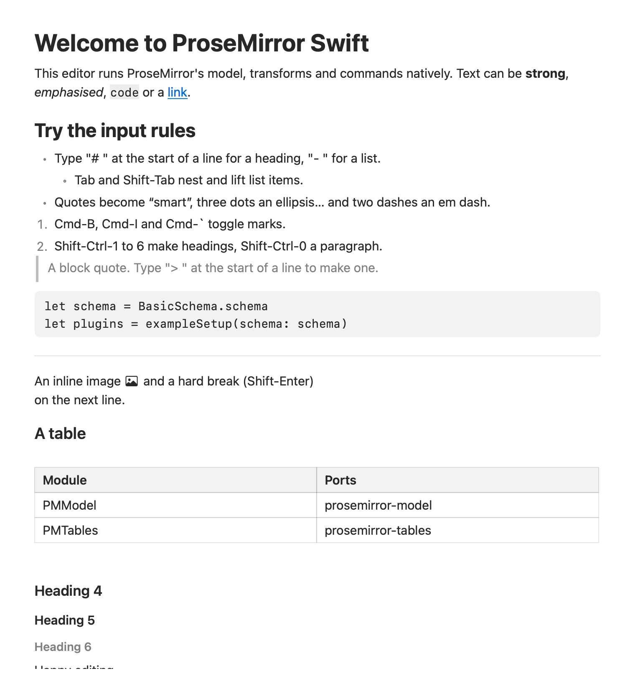

<p align="center"></p>

# ProseMirrorSwift

A native Swift port of [ProseMirror](https://prosemirror.net) for macOS and iOS, with a
TextKit 2 editor view, tables, and real-time collaboration through Yjs.

It isn't a wrapper around a web view. The document model, transforms, state, commands,
history and the rest are ported line for line, and every one is checked against the real
JavaScript ProseMirror running in JavaScriptCore: the same random documents, edits and
editing sessions go through both, and the results must match exactly.

<picture>
  <source media="(prefers-color-scheme: dark)" srcset="docs/images/editor-dark.png">
  
</picture>

> This is an unofficial port. ProseMirror is the work of Marijn Haverbeke and contributors;
> please support the original project.

**Status: early (0.x).** It powers a shipping Mac and iOS app, but the public API may still
change before 1.0.

## Modules

| Swift module | Ports | JS version |
|---|---|---|
| `PMModel` | prosemirror-model (no DOM parser or serializer) | 1.25.11 |
| `PMTransform` | prosemirror-transform | 1.12.1 |
| `PMState` | prosemirror-state | 1.4.4 |
| `PMCommands` | prosemirror-commands, plus prosemirror-schema-list's commands | 1.7.2 / 1.5.1 |
| `PMKeymap` | prosemirror-keymap (with w3c-keyname) | 1.2.3 |
| `PMInputRules` | prosemirror-inputrules | 1.5.1 |
| `PMHistory` | prosemirror-history | 1.5.0 |
| `PMMarkdown` | prosemirror-markdown's serializer, and tiptap-markdown's serializer state | 1.13.7 / 0.8.10 |
| `PMTables` | prosemirror-tables: table map, cell selection, fixing, commands, paste | 1.8.5 |
| `YSync` | y-prosemirror's sync plugin, on yrs (the Rust Yjs) | 1.3.7 |

Native views, in place of prosemirror-view:

| Swift module | What it is |
|---|---|
| `PMTextKit` | The editor view: a TextKit 2 `NSTextView` (macOS) or `UITextView` (iOS) driven by an `EditorState`. You describe how nodes and marks look through the `DocStyle` protocol. |
| `PMTableView` | A native table view that `PMTextKit` embeds for table nodes: grid, cell editing, row and column handles. |
| `PMExampleSetup` | The counterpart of prosemirror-example-setup: a basic schema with lists and tables, input rules, keymaps, history, and `BasicStyle`, a ready-made `DocStyle`. Start here. |

`prosemirror-view` itself isn't ported: views implement the small `EditorView` protocol in
`PMState` (state, dispatch, end-of-textblock checks, composition).

## Requirements

- macOS 13 or later, iOS 16 or later
- Swift 6 toolchain (Xcode 16 or later); the package builds in the Swift 5 language mode

## Installation

Add the package in Xcode (File → Add Package Dependencies…) or in `Package.swift`:

```swift
dependencies: [
    .package(url: "https://github.com/jmaorr/ProseMirrorSwift.git", from: "0.1.0"),
],
targets: [
    .target(name: "MyApp", dependencies: [
        .product(name: "PMExampleSetup", package: "ProseMirrorSwift"),
        .product(name: "PMTextKit", package: "ProseMirrorSwift"),
    ]),
]
```

Depend only on the modules you use: the model and state modules have no UI dependencies.

## Quick start

```swift
import PMExampleSetup
import PMState
import PMTextKit

let schema = BasicSchema.schema
let doc = try schema.nodeFromJSON([
    "type": "doc",
    "content": [["type": "paragraph", "content": [["type": "text", "text": "Hello"]]]],
])
let state = EditorState.create(EditorStateConfig(doc: doc, plugins: exampleSetup(schema: schema)))
let editor = BasicStyle().makeTextView(state: state)
```

`editor` is a `ProseTextView`: an `NSTextView` on macOS and a `UITextView` on iOS, so put it
in your view hierarchy like any other. `makeTextView` also wires up native tables. Every
change goes through a transaction, as in ProseMirror.

Try the example apps:

```bash
swift run ExampleEditor                     # macOS
open Examples/iOS/*.xcodeproj               # iOS, then run in the Simulator
```

## Collaboration

`YSync` keeps an editor in sync with a Yjs document the way y-prosemirror does, so a Swift
editor and a web editor using Tiptap's collaboration extension or y-prosemirror can edit the
same document. `YWebsocketProvider` speaks the y-websocket protocol (as y-websocket and
y-partyserver servers do).

To try it against the JavaScript stack, run the local relay and browser editor, then join
the same room from the example app:

```bash
cd devserver && npm install && npm start     # http://localhost:1234/?room=demo
```

yrs ships prebuilt as `Yrs.xcframework` (macOS, iOS, iOS Simulator). `yrs-ffi/build.sh`
rebuilds it from source.

## What's supported, and what isn't

- **Ported:** the packages in the table above, including their edge cases; the parity
  suite runs them against the JavaScript originals.
- **Not ported:** prosemirror-view (replaced by PMTextKit), the DOM parser and serializer
  (`DOMParser` / `DOMSerializer`), Markdown *parsing* (serializing is ported),
  prosemirror-gapcursor, prosemirror-dropcursor.
- **Different by design:** node views are native. Instead of `toDOM` and node views, a
  `DocStyle` returns text attributes, block decorations, chrome boxes, controls and embedded
  views for each node.

## How it's tested

```bash
swift test
```

`oracle/dist/oracle.js` bundles the pinned JavaScript packages and a small JSON harness. The
tests load it into JavaScriptCore, feed the same inputs to JavaScript and Swift, and compare
the results: random documents, random transform sequences, random editing sessions (keys,
typing, selection changes, undo), Yjs round trips, and the hand-written scenarios in
`fixtures/scenarios/`. Two schemas are fuzzed: prosemirror-schema-basic with lists, and a
Tiptap-style schema with tables, task lists and attributes. Scale the fuzzers with
`PM_FUZZ_SCALE=10`.

See [CONTRIBUTING.md](CONTRIBUTING.md) for rebuilding the oracle and adding scenarios.

Found a security problem? Please report it privately; see [SECURITY.md](SECURITY.md).

## Credits and licence

ProseMirrorSwift is MIT licensed; see [LICENSE](LICENSE).

It ports MIT-licensed work by others, and keeps their notices:
- [ProseMirror](https://prosemirror.net), © Marijn Haverbeke and others: [LICENSE-PROSEMIRROR](LICENSE-PROSEMIRROR)
- [prosemirror-tables](https://github.com/ProseMirror/prosemirror-tables): [LICENSE-PROSEMIRROR-TABLES](LICENSE-PROSEMIRROR-TABLES)
- [tiptap-markdown](https://github.com/aguingand/tiptap-markdown), © Antoine Guingand: [LICENSE-TIPTAP-MARKDOWN](LICENSE-TIPTAP-MARKDOWN)
- [yrs](https://github.com/y-crdt/y-crdt), © Kevin Jahns, Bartosz Sypytkowski and contributors: [LICENSE-YRS](LICENSE-YRS)
